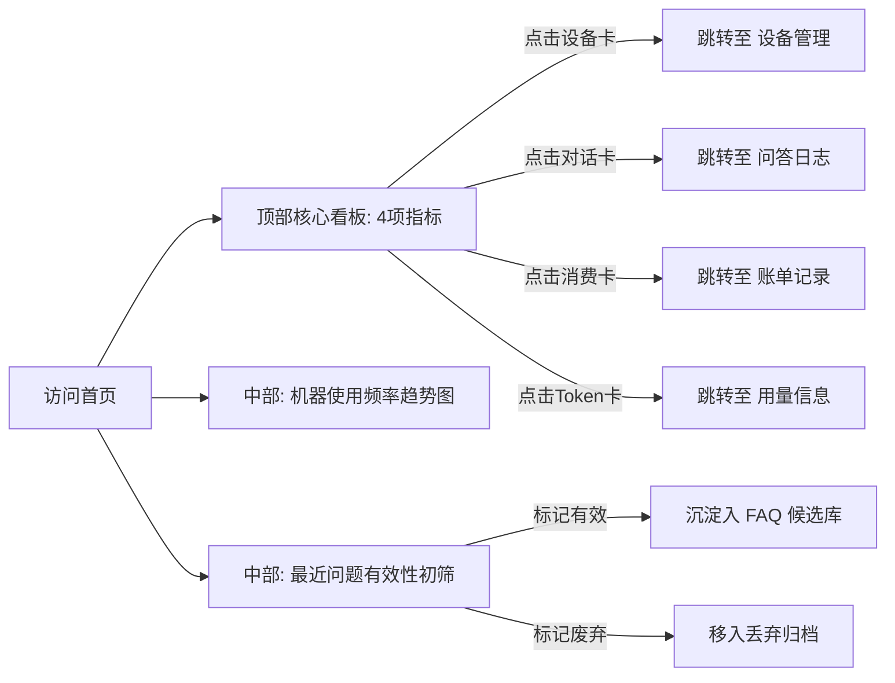
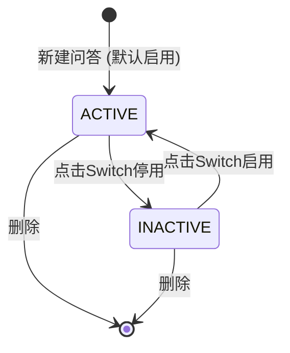
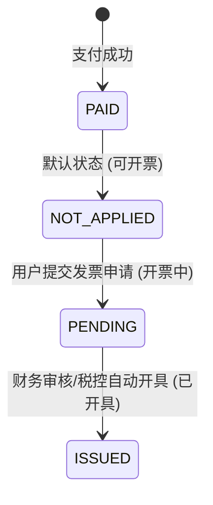
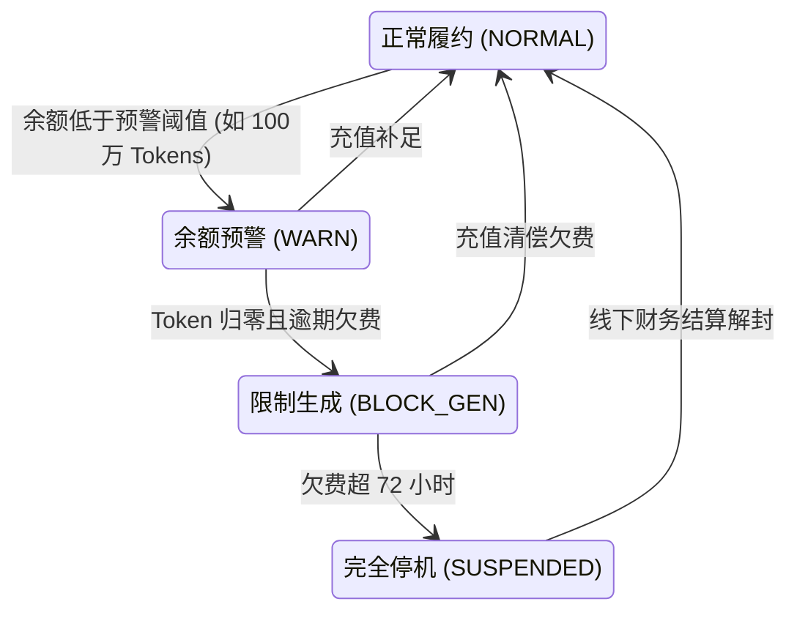

# 多租户数字人用户端（租户工作台）产品需求规格说明书 (PRD)

> **版本**：v1.0.0  
> **文档定位**：梳理多租户数字人用户端（租户工作台）各模块功能范围、操作流程、字段说明、状态流转、异常与权限规则，消除“看页面猜业务”的模糊地带。  
> **标记规范**：
> - ✅ **【已确定】**：当前代码已完整实现并落地的交互、字段与业务逻辑。
> - ❓ **【待定/建议确认】**：前端已有雏形或设计预留，但需产品、算法、硬件或后端进一步对齐明确的规则。

---

## 一、全局架构与页面骨架规范

### 1.1 页面空间布局标准
- ✅ **【已确定】顶部导航栏（ClientTopHeader - 56px）**：
  - 展示当前租户名称与商户唯一编码（如 `CUST-1001`）。
  - Token 算力余额实时展示，提供“立即充值”高亮入口，点击呼起充值弹窗。
  - 右侧提供“切换管理后台（运营端）”快捷通道（仅限具备双重权限的操作员）。
  - 用户头像与退出登录下拉菜单。
- ✅ **【已确定】侧边栏导航（ClientSidebar - 224px 纯白背景）**：
  - 一级业务模块：`首页`、`机器管理`、`管理内容`、`通用设置`、`费用`。
  - 严格采用清晰短名称，绝无装饰性中英文混杂后缀。
- ✅ **【已确定】次级导航条（ClientSubNavBar - 56px 吸顶固定）**：
  - **首页**：自动隐藏二级次级导航条，释放全屏展示空间。
  - **其他业务模块**：顶部固定 56px 次级导航，支持单页面内二级菜单平滑切换与激活高亮。
- ✅ **【已确定】底栏分页规范（ClientTableFooter - 56px 吸附底栏）**：
  - 列表页（设备列表、问答日志、FAQ、知识库、敏感词、账单）统一采用独立吸附底栏。
  - 左侧展示：“共 X 条记录 / 已选 Y 项”，右侧标准 Arco Pagination（支持每页 10/20/50 条切换）。表格主体严禁内嵌双重分页。
- ✅ **【已确定】通用设置设备卡片前置选择流**：
  - 用户点击“通用设置”相关子页面（或“设备控制/设备应答”）时，若尚未指定目标终端，自动呈现 `ClientSettingDeviceCardsView`（设备卡片栅格选择页）。
  - 用户选定某台大屏后，路由与上下文即刻锁定该终端，平滑进入具体配置详情。

---

## 二、首页 (Overview Dashboard)

### 2.1 功能范围
为租户提供企业资产、今日交互吞吐、财务成本与待处理问题的全局监控看板，作为每日运营起点。

### 2.2 核心指标与操作流

### 2.3 字段说明
| 区域 | 字段 / 元素 | 类型 | 取值说明 | 业务定义 |
| :--- | :--- | :--- | :--- | :--- |
| **顶部指标** | 设备总数 | 数字 | 统计绑定至该租户下的终端总数 | 点击直达设备列表 |
| | 今日对话 | 数字 | 当日自然日（00:00~当前）全设备语音交互总会话数 | 点击直达问答日志 |
| | 本月消费 | 金额 | 当月实际产生的消耗折合金额（元） | 点击直达账单列表 |
| | Token用量 | 数字 | 当前账户剩余可用 Token 余额 | 点击直达用量中心 |
| **机器频率** | 统计维度 | 枚举 | `DAY`（日，4小时粒度）/ `WEEK`（周，天粒度）/ `MONTH`（月，周粒度） | 切换折线图 X 轴聚合颗粒度 |
| | 调用频次 | 数字 | SVG 交互折线，悬浮点展示精确次数 | 反映线下展厅人流量与交互热度 |
| **最近问题** | 提问文本 | 文本 | 访客语音转文字（ASR）提问原文 | 截取最新 5 条未精准匹配的提问 |
| | 操作行为 | 按钮 | 「有效」（蓝色）/「废弃」（灰红） | 有效：确认有商业价值；废弃：无效噪音 |

### 2.4 状态与异常规则
- ✅ **【已确定】指标实时联动**：Token 余额与充值、模拟调用实时联动更新。
- ❓ **【待定/建议确认】最近问题沉淀机制**：
  - 点击“有效”后，当前前端仅弹出全局提示；建议确认：是否直接弹窗呼起“转为 FAQ 标准问答”，让运营员补充标准答案后直接发布？

---

## 三、机器管理 (Machine Management)

### 3.1 模块结构
包含 5 个二级功能：**设备管理**、**设备应答**、**问答日志**、**设备控制**、**上传LOGO**。

---

### 3.2 子模块 1：设备管理 (`client-device-list`)
#### 功能范围
查看当前租户名下所有大屏一体机硬件终端的实时状态、网络连通性，并支持软重启维护。
#### 操作流程
1. 查看列表，支持搜索设备名称、MAC 地址、局域网 IP。
2. 查看当前心跳时间、运行模式及当前音量。
3. 点击“软重启”按钮，二次确认后向大屏下发重启指令。
#### 字段说明
- `name`：设备名称（如“1号展厅迎宾主屏”）。
- `macAddress`：硬件物理 MAC 地址（唯一标识，如 `70:85:C2:5E:21:01`）。
- `ip`：局域网/公网 IP 地址。
- `status`：网络状态，枚举：`ONLINE`（在线，绿色）、`OFFLINE`（离线，灰色）。
- `activeMode`：运行模式，枚举：`STANDBY`（待机迎宾）、`SHOWCASE`（全景展播）、`MARKETING`（互动问答）。
- `volume`：硬件输出音量（0~100%）。
- `lastHeartbeat`：最后心跳时间戳（超过 90 秒未上报则判定为 OFFLINE）。
#### 状态与异常
- ✅ **【已确定】软重启防护**：Modal 二次确认弹窗，明确提示“系统将在 30 秒内完成引擎重新加载”。
- ❓ **【待定/建议确认】离线设备指令排队**：设备处于 `OFFLINE` 时，下发重启或模式变更是否进入 MQTT 离线消息队列？离线设备是否应置灰禁用操作？

---

### 3.3 子模块 2：设备应答 (`client-device-greetings`)
#### 功能范围
为指定或全局终端配置数字人主动问候语、自我介绍话术、超时兜底及语种切换提示。
#### 操作流程
- **Tab 1（自我介绍 INTRO）**：
  - 支持多语种列表（中文简体、English、繁體中文、自定义语种）。
  - 可勾选是否启用该语种，录入对应语音台词。
- **Tab 2（分时段问候语 GREETINGS）**：
  - 配置早晨（06:00~11:59）、午间（12:00~17:59）、晚间（18:00~次日05:59）问候语。
  - 静音兜底超时时长：Slider 滑动选择（5~60秒）。
  - 未听清/未命中兜底应答语配置。
- **Tab 3（语种切换提示词 SWITCH_PROMPT）**：
  - 访客说出“请说英语”或切换语种时，数字人过渡播报的提示词（如“已为您切换至中文普通话解说模式”）。
- 点击“保存设置”即时生效，支持“恢复默认”一键还原标准模板。
#### 字段说明
- `selfIntro` (string)：自我介绍基础文本。
- `greetingMorning / greetingDay / greetingNight` (string)：早/中/晚问候语。
- `silenceTimeoutSec` (number)：静音等待秒数（默认 15s）。
- `fallbackReply` (string)：兜底应答话术。
- `switchPrompts` (object)：包含 `zhPrompt`, `enPrompt`, `cantonesePrompt`。
#### 状态与待定
- ✅ **【已确定】多语种列表增删**：支持动态添加自定义语言条目与删除操作（至少保留 1 种语言）。
- ❓ **【待定/建议确认】离线语音合成能力**：切换到英文或繁体时，大屏端本地 TTS 是否内置离线多语种发音人？若无网络时外语是否支持离线播放？

---

### 3.4 子模块 3：问答日志 (`client-device-logs`)
#### 功能范围
审计所有终端的语音对话历史，分析耗时、Token 成本及应答命中来源，支持按条件导出 CSV。
#### 操作流程
1. 下拉筛选目标设备 MAC（或选择全部设备）。
2. 下拉筛选应答来源（`全部来源` / `精准 FAQ` / `知识库 RAG` / `模型生成` / `兜底应答`）。
3. 关键词检索提问、回答或设备名称。
4. 点击“导出 CSV”，浏览器生成并下载 UTF-8 编码问答明细表。
#### 字段说明
- `id`：日志记录唯一 ID。
- `mac` & `deviceName`：触发终端 MAC 与设备名称。
- `userQuestion`：访客 ASR 识别文本。
- `replyText`：数字人 TTS 播报回复文本。
- `hitType`：应答来源枚举：
  - `FAQ_EXACT`（精准问答库命中，消耗 0 或极低 Token）
  - `RAG_DOC`（企业知识库检索切片增强生成）
  - `LLM_GEN`（通用大模型自主生成）
  - `FALLBACK`（未识别/静音兜底话术）
- `latencyMs`：全链路端到端耗时（ASR + LLM/RAG + TTS 合成延迟，毫秒）。
- `tokensConsumed`：单次对话消耗的 Token 算力数。
- `timestamp`：对话触发时间。
#### 状态与待定
- ✅ **【已确定】本地防 CSV 注入导出**：导出的文本字段包含转义处理，防止双引号解析错位。
- ❓ **【待定/建议确认】录音音频回溯**：问答日志是否需要支持试听现场访客的原始录音与数字人合成音频？

---

### 3.5 子模块 4：设备控制 (`client-device-control`)
#### 功能范围
对大屏进行实时远程控制，包括模式切换、形象换装、音量调节与电源/屏幕管理。
#### 操作流程
1. **运行模式切换**：单选切换「待机迎宾」、「全景展播」、「营销推荐」，点击即时下发。
2. **服装换装**：选择当前形象预设的服装款式（如“西湖传统青绿套装”、“商务职业深蓝正装”），点击即下发换装。
3. **硬件音量**：滑动 Slider（0~100%），即时同步大屏音量。
4. **电源与屏幕管理**：
   - 「重启应用」：触发应用进程重启（软重启）。
   - 「息屏 / 唤醒」：远程关闭屏幕背光或唤醒。
   - 「远程关机」：弹出红色 Danger 二次确认弹窗，明确提示“关机后需现场人工开启电源”。
#### 状态与待定
- ✅ **【已确定】危险指令二次防护**：远程关机与重启均具备弹窗防误触。
- ❓ **【待定/建议确认】关机后的网络唤醒**：关机后设备彻底脱机，硬件是否接入智能 PDU 插座或支持 Wake-on-LAN (WOL)？若不支持，界面需强化“无法远程开机”的显著提示。

---

### 3.6 子模块 5：上传LOGO (`client-device-logo`)
#### 功能范围
为大屏展示画面配置租户企业的专属品牌标识（角标 LOGO）。
#### 操作流程
1. 选择上传本地图片（PNG/JPG）或输入网络图片 URL。
2. 可从“官方预设徽标库”中一键点选预设。
3. 选择 LOGO 悬浮位置：`左上角 (TOP_LEFT)` 或 `右上角 (TOP_RIGHT)`。
4. 右侧提供大屏渲染比例模拟器，实时预览品牌贴角效果。
5. 点击“保存设置”，同步下发至大屏渲染层。
#### 字段说明
- `logoUrl` (string)：图片资源绝对地址。
- `logoPosition` (string)：`TOP_LEFT` / `TOP_RIGHT`。
- ✅ **【已确定】即时预览与存储**：支持浏览器端 ObjectURL 本地预览与全局 Context 状态保持。

---

## 四、内容管理 (Content Management)

### 4.1 子模块 1：Q＆A问答 (`client-content-faq`)
#### 功能范围
维护企业的固定 FAQ 精准问答库，拦截通用大模型的不确定性输出，保证企业业务政策回复的 100% 确定性。
#### 操作流程
1. **查看与搜索**：支持按问题、回答、相似问关键词实时过滤。
2. **新增/编辑问答（Modal 弹窗 - 520px）**：
   - 标准问题（必填，单行文本）。
   - 标准解答（必填，多行文本）。
   - 相似问法（选填，多行文本，支持换行或逗号自动分割为相似问列表）。
   - 启用状态开关（默认开启）。
3. **行内操作**：
   - 状态 Switch 切换：快速停用/启用单条问答。
   - 删除：弹窗确认后移除。
4. **批量操作**：支持表格多选后批量删除与导出。
#### 字段说明
- `question` (string, 必填)：标准提问词。
- `similarQuestions` (string[])：扩展相似问法集合。
- `answer` (string, 必填)：标准答案文本。
- `hitCount` (number)：历史累计命中次数。
- `status` (enum)：`ACTIVE`（生效中） / `INACTIVE`（已停用）。
- `createTime` (string)：创建时间。
#### 状态流转

- ✅ **【已确定】去分类化**：已根据最新需求去除冗余的分类标签栏，搜索框统一置左。
- ❓ **【待定/建议确认】富媒体与卡片应答**：FAQ 是否需要支持回复附带图片、视频、URL 外链或大屏跳端指令？

---

### 4.2 子模块 2：知识库管理 (`client-content-kb`)
#### 功能范围
通过上传企业专业文档（Word/PDF/Excel/TXT），构建端云一体的 RAG 知识检索库，支持相似度检索测试与离线大屏同步。
#### 操作流程
1. **上传文档（Modal 弹窗）**：
   - 上传本地文件，自动解析切片。
   - 配置切片策略：分块大小（512 / 1024 tokens）、重叠率（10% / 20%）。
   - 选择 Embedding 向量模型（如 `text-embedding-3-large`、`bge-large-zh-v1.5`）。
2. **检索测试（Modal 弹窗）**：
   - 输入测试 Query，点击检索。
   - 实时返回召回的切片片段（Chunk Content）、来源文档及相似度分值（如 `0.94`、`0.88`）。
3. **同步至端侧离线向量库**：
   - 点击“同步至端侧离线向量库”，系统将云端向量索引打包下发至局域网大屏，支持断网环境下的本地向量检索。
#### 字段说明
- `id`：文档唯一编号（如 `DOC-001`）。
- `name`：文档原始文件名。
- `type`：格式枚举：`PDF` / `DOCX` / `XLSX` / `TXT`。
- `size`：文件大小。
- `chunksCount`：文档解析后生成的切片总数。
- `status`：状态枚举：
  - `READY`（解析完成就绪）
  - `INDEXING`（向量切片构建中）
  - `SYNCED`（已成功同步至终端硬件）
- `embeddingModel`：所采用的向量模型。
#### 状态与待定
- ✅ **【已确定】Docling 与切片仿真**：支持检索召回测试沙箱与端侧同步指令模拟。
- ❓ **【待定/建议确认】向量库离线同步带宽策略**：大屏硬件本地存储容量较小时，离线向量文件是覆盖式全量同步还是增量 Patch 同步？

---

### 4.3 子模块 3：敏感词管理 (`client-content-sensitive`)
#### 功能范围
维护企业级违禁与风险词库，配置多等级实时拦截策略，并在大屏端与云端双重过滤，防止政治合规或商业侵权风险。
#### 操作流程
1. **单条添加**：录入违禁词、选择处置策略与风险等级。
2. **批量导入**：在文本框内多行粘贴或逗号分割词条，一键批量解析导入。
3. **实时命中测试（Modal 弹窗）**：
   - 输入一段含敏感词的模拟对话内容（如“请问怎么退钱？你们是不是诈骗”）。
   - 实时反馈命中的敏感词列表及脱敏/拦截后的最终呈现效果。
#### 字段说明
- `word` (string, 必填)：敏感词文本。
- `category` (enum)：`政治合规` / `竞品商誉` / `粗俗辱骂` / `虚假欺诈` / `自定义违禁`。
- `strategy` (enum)：处置策略：
  - `POLITE_REJECT`（礼貌婉拒：触发预置礼貌拒绝话术）
  - `REPLACE_STAR`（文本替换：将敏感字替换为 `***` 并继续回答）
  - `TERMINATE_SESSION`（终止会话：高危红线，立即强制中断当前对话并告警）
- `level` (enum)：`HIGH`（高危） / `MEDIUM`（中等） / `LOW`（低风险）。
- `hitCount` (number)：历史拦截触发计数。
#### 状态与待定
- ✅ **【已确定】实时沙箱测试机制**：测试弹窗即时输出命中详情。
- ❓ **【待定/建议确认】敏感词云端全局继承**：租户端的敏感词库是否基于平台全局法规模板自动继承？租户是否允许覆盖平台默认红线词？

---

## 五、通用设置 (General Settings)

### 5.1 设备配置 (`client-setting-device`)
#### 功能范围
配置目标大屏的音色绑定、交互输出模式以及人设方案的快速挂接。
#### 操作流程
1. 顶部确认当前生效的目标设备（或全部设备）。
2. **音色配置**：从系统音色库（如通用女声、知性播音、亲切男声）中点选，支持点击喇叭图标进行浏览器语音在线试听。
3. **返回内容选择**：单选切换「仅文本 (TEXT)」或「文本+音频 (TEXT_AUDIO)」。
4. **人设卡片绑定**：展示预设的人设卡片列表（如“小仁”、“你好”、“老人”等），单选完成人设 Profile 挂接。
5. 点击“保存配置”，系统提示“保存成功，请重启终端应用使底层算法参数生效”。
#### 字段说明
- `selectedVoiceId`：选定音色 ID。
- `returnContentType`：`TEXT` / `TEXT_AUDIO`。
- `selectedPersonaId`：关联人设 Profile ID。
- ✅ **【已确定】在线试听与绑定**：利用 Web Speech API 模拟试听，保存后提供清晰重启提示。

---

### 5.2 资产配置 (`client-setting-assets`)
#### 功能范围
为租户提供数字人形象立绘库选择、预设服装搭配，以及针对专属形象的定制工单申请入口。
#### 操作流程
1. **形象选择**：浏览左侧形象库卡片（含形象封面、角色标签），点击选中目标形象。
2. **服装搭配**：右侧展示与当前形象适配的服装套装（如“深蓝职业商务西服”、“优雅正装白色衬衫”、“盛典刺绣迎宾旗袍”等），单选切换。
3. **设为默认**：点击“设为默认”，将当前形象与服装方案下发为该租户大屏的开机默认外观。
4. **申请定制形象（Modal 弹窗）**：
   - 录入期望形象名称、拟应用业务场景（如文旅、政务、金融）。
   - 提交工单后，系统通知商务经理对接。
#### 字段说明
- `selectedAvatarId`：选定形象 ID。
- `selectedOutfitId`：选定服装套餐 ID。
- `customName / customScene`：定制形象申请表单字段。
- ✅ **【已确定】形象服装方案联动**：选中立绘卡片与右侧服装预览即时联动。

---

### 5.3 人设配置 (`client-setting-persona`)
#### 功能范围
定义数字人的灵魂核心，包括名称、System Prompt 系统提示词、严谨度控制以及 TTS 基础语速与语调。
#### 操作流程
1. **套用人设模板**：提供「科技展厅金牌讲解员」、「政务便民大厅接待专员」、「智慧零售金牌导购」三大人设模版，点击一键填充对应设定。
2. **Prompt 深度定制**：在多行文本域中按格式微调核心任务、禁止事项、回答字数控制。
3. **严谨度控制（严格遵循知识库）**：
   - `HIGH`（严谨规范：完全依据知识库回答，不推测）
   - `MEDIUM`（平衡模式：基于知识库启发式解答，语言亲切）
   - `CREATIVE`（活泼推荐：语言生动，适合营销）
4. **语音基准调优**：
   - 语速倍率（0.5x ~ 2.0x，步长 0.1x）。
   - 语调音高（-50% ~ +50%）。
   - 支持“在线试听音色”按钮，实时朗读人设问候。
5. 点击“保存人设”，即时生效。
#### 字段说明
- `personaName` (string)：数字人对外自称姓名。
- `systemPrompt` (string)：系统级底层指令。
- `strictness` (enum)：`HIGH` / `MEDIUM` / `CREATIVE`。
- `speechSpeed` (number)：语速（默认 1.0）。
- `speechPitch` (number)：语调（默认 1.0）。
- ✅ **【已确定】双 Tab 交互分离**：PROMPT 人设逻辑与问候语配置互相独立，结构清晰。

---

### 5.4 场景配置 (`client-setting-canvas`)
#### 功能范围
所见即所得的大屏 UI 画布编辑器，配置横/竖屏背景、数字人站位、金刚区快捷按键及画中画媒体窗。
#### 操作流程
1. **画布方向切换**：支持「竖屏模式 (PORTRAIT - 9:16)」与「横屏模式 (LANDSCAPE - 16:9)」预览切换。
2. **背景设置**：
   - 纯色背景：支持一键选用科技蓝、商务黑、米白等预设色值。
   - 图片背景：支持选用官方展厅背景图或上传自定义实景背景图。
3. **数字人站位**：单选切换「居左 (LEFT)」、「居中 (CENTER)」、「居右 (RIGHT)」，预览区立绘位置即时响应。
4. **金刚区快捷按键（KingKong Buttons）**：
   - 录入按钮名称（如“展区导览”、“最新优惠”）及触发提示词（Prompt）。
   - 点击“添加按键”，画布底部即时呈现对应药丸按键；支持点击删除移除。
5. **画中画媒体窗**：开关控制是否在大屏右上角悬浮宣传视频/图片展播浮层。
6. 点击“保存配置”，下发至大屏渲染器。
#### 字段说明
- `bgType`：`COLOR` / `IMAGE`。
- `bgColor` / `bgImageUrl`：色值或图片 URL。
- `avatarPosition`：`LEFT` / `CENTER` / `RIGHT`。
- `kingkongButtons`：数组，包含 `{ id, label, prompt }`。
- `showMediaOverlay`：布尔值。
- `mediaOverlayTitle` & `mediaOverlayUrl`：画中画标题与流媒体地址。
- ✅ **【已确定】所见即所得双屏模拟器**：支持 9:16 / 16:9 实时物理比例响应。

---

## 六、费用中心 (Billing & Recharge)

### 6.1 子模块 1：用量信息 (`client-billing-usage`)
#### 功能范围
为租户提供透明的算力消耗仪表盘，分析 Token 余额、日均消耗趋势、日均交互频次并预测可用天数。
#### 操作流程
1. 查看顶部指标带：Token 余额、累计消耗、日均支出、预计可用天数。
2. 切换时间范围：近 7 天 / 近 30 天消耗柱状图/面积图。
3. 点击“导出报表”，下载每日消耗对账 CSV 文件。
#### 字段说明
- `tokenBalance`：可用 Token 算力余额。
- `totalTokensUsed`：租户生命周期累计消耗。
- `dailyCost`：近 7 日均消耗。
- `estimatedDays`：根据日均消耗计算的可用天数余额。
- ✅ **【已确定】Stripe 风格指标条**：开阔通透的指标排布，无臃肿卡片框线。

---

### 6.2 子模块 2：算力充值 (`client-billing-recharge`)
#### 功能范围
租户自主选购标准化算力包或输入自定义金额，通过微信、支付宝或对公打款进行充值注资。
#### 操作流程
1. **选购套餐**：
   - 套餐 A：¥1,000 → 1,000 万 Tokens（约 2.5 万次交互）。
   - 套餐 B（推荐）：¥5,000 → 6,000 万 Tokens（赠 1,000 万 Tokens）。
   - 套餐 C：¥20,000 → 3 亿 Tokens（赠 1 亿 Tokens）。
2. **自定义金额**：输入自定义充值金额（最低 ¥100 起），系统按 1元=10,000 Tokens 自动换算。
3. **支付渠道**：单选切换「微信支付」、「支付宝」、「对公银行汇款」。
4. 点击“立即充值”，呼出收银台确认弹窗，确认后模拟完成支付，Token 余额即刻到账并产生支付流水。
#### 字段与校验
- 最低充值金额限制：¥100 起，小于 100 阻断提交并弹出警告。
- ✅ **【已确定】即时入账与多渠道适配**：支持平台全局状态即时更新与提示。

---

### 6.3 子模块 3：账单与发票 (`client-billing-bills`)
#### 功能范围
查看充值流水账单，下载财务对账单，并针对已付款订单在线申请增值税电子发票。
#### 操作流程
1. **订单筛选**：Tab 胶囊切换「全部」、「可开票」、「已开票」，或输入订单号搜索。
2. **申请发票（Modal 弹窗）**：
   - 针对未开票订单点击“申请发票”。
   - 录入企业发票抬头、统一社会信用代码（税号）、发票接收邮箱。
   - 提交后，该订单开票状态流转为“开票中”，并给出成功提示。
3. **导出账单**：点击“导出 CSV”，导出全量充值流水。
#### 字段说明
- `tradeNo` / `id`：充值订单流水号（如 `PAY-1001`）。
- `amountRmb`：支付金额（元）。
- `channel`：支付方式（微信 / 支付宝 / 银行电汇）。
- `paidAt`：支付完成时间。
- `status`：订单状态（`PAID` / `PENDING` / `REFUNDED`）。
- `invoiceStatus`：开票状态（`NOT_APPLIED` 可开票 / `PENDING` 开票中 / `ISSUED` 已开具）。
#### 状态流转

- ✅ **【已确定】发票抬头自动预填**：自动读取当前租户名称作为默认抬头。
- ❓ **【待定/建议确认】自动税控开票接口**：当前提交为流转至 `PENDING`；后续是否需要对接百旺/航信税控 API 自动开具全电发票并自动发信？

---

## 七、状态机流转、异常与降级规则

### 7.1 租户欠费状态机 (Kill Bill 状态流转)
租户的账户状态与大屏硬件交互权限严格联动：

#### 各状态下终端表现规则
| 状态 | 云端服务能力 | 大屏终端表现 | 离线降级策略 |
| :--- | :--- | :--- | :--- |
| **NORMAL (正常)** | 全部开放（LLM / RAG / TTS / 渲染） | 正常运行全功能 | 正常 |
| **WARN (预警)** | 全部开放，后台触发邮件/短信催缴 | 正常运行，控制台顶部标黄提醒 | 正常 |
| **BLOCK_GEN (限流)** | 阻断通用大模型调用与 RAG 深度检索 | 仅允许触发本地 FAQ 精准问答 | **开启降级**：无法解答时统一播报兜底话术，禁止产生云端费用 |
| **SUSPENDED (停机)** | 全部阻断，切断 WebSocket 连接 | 大屏黑屏或显示“系统维护中，请联系客服” | 终端切断交互，拒绝所有语音输入 |

- ❓ **【待定/建议确认】降级切换提示词**：进入 `BLOCK_GEN` 时，大屏是否应主动向现场播报提示，还是静默降级为仅 FAQ？

---

### 7.2 终端弱网与断网离线降级机制
- ✅ **【已确定】**：大屏一体机内置轻量化离线缓存机制。
- **离线问答逻辑**：
  1. 访客语音输入 → 本地轻量 ASR 模块转文字。
  2. 优先匹配本地 SQLite 中的精确 FAQ 库。
  3. 若匹配失败，检索本地离线向量索引库（已同步的切片）。
  4. 若仍未命中或未联网，播报本地预设的 `fallbackReply`（如“抱歉现场信号稍有延迟，您可以换个问题问我哦...”）。
- ❓ **【待定/建议确认】离线日志补录**：断网期间大屏本地记录的问答日志，在网络恢复后是否自动批量补传（Batch Upload）至云端 `sai_token_log`？

---

## 八、权限与租户隔离规则

### 8.1 租户数据硬隔离
- ✅ **【已确定】所有数据请求必须携带租户标识**：
  - 前端所有视图组件通过 `currentTenantId` 进行数据过滤（如设备列表仅展示当前租户名下设备，日志与账单均隔离）。
  - 后端接口层（Spring Boot + MyBatis-Plus）必须基于 JWT Claims 中的 `tenant_id` 自动拼装 SQL 租户拦截条件，严禁越权水平越权（IDOR）。

### 8.2 用户端角色权限体系（待定设计）
当前前端模拟了全局操作者视角，后续进入多账号企业管理时建议规划的角色矩阵：

| 角色代码 | 角色名称 | 机器管理 | 内容管理 | 通用设置 | 费用充值 | 权限边界 |
| :--- | :--- | :---: | :---: | :---: | :---: | :--- |
| `ROLE_TENANT_ADMIN` | 企业主账号/管理员 | ✅ 读写 | ✅ 读写 | ✅ 读写 | ✅ 读写 | 全功能开放，可充值、改人设、管理设备 |
| `ROLE_HALL_OPERATOR` | 展厅现场值班员 | ✅ 控制 | ❌ 仅看 | ❌ 仅看 | ❌ 无权 | 仅允许设备远程控制（关机/重启/换衣服），禁止动 Prompt 或充值 |
| `ROLE_CONTENT_EDITOR` | 知识库运营员 | ❌ 仅看 | ✅ 读写 | ❌ 仅看 | ❌ 无权 | 负责问答 FAQ 录入、资料文档切片与敏感词配置 |
| `ROLE_FINANCE` | 财务主管 | ❌ 无权 | ❌ 无权 | ❌ 无权 | ✅ 读写 | 负责费用充值、查看用量走势与开具增值税发票 |

- ❓ **【待定/建议确认】租户端是否需要在本次交付中开放子账号管理界面**，还是首期仅支持单一企业主账号登录？

---

## 九、总结：重点待定确认项清单 (Action Items)

为加速后续开发与产品闭环，建议近期重点对齐以下 6 项决策：

| 序号 | 待定事项 | 涉及模块 | 当前实现 / 现状 | 建议对齐决策 | 优先级 |
| :---: | :--- | :--- | :--- | :--- | :---: |
| **1** | **硬件远程关机与唤醒网络通路** | 机器管理-设备控制 | 前端已提供远程关机与软重启 | 确认硬件大屏是否支持 WOL 唤醒或智能插座？若无法开机，界面是否增加不可逆提示？ | P0 |
| **2** | **欠费降级策略与大屏应答规则** | 状态机/设备应答 | 前端定义了四态流转 | 欠费进入 `BLOCK_GEN` 时，终端是否静默降级为仅 FAQ，并屏蔽大模型？ | P0 |
| **3** | **端侧离线向量库同步机制** | 内容管理-知识库管理 | 前端已提供一键同步按钮 | 离线向量文件是全量覆盖打包还是差量增量推送？离线日志恢复后是否自动补传？ | P1 |
| **4** | **多语种离线语音发音人** | 机器管理-设备应答 | 前端支持中文/英文/繁体切换 | 确认大屏一体机硬件是否搭载多语种离线 TTS 引擎？ | P1 |
| **5** | **首页最近问题沉淀机制** | 首页概览 | 点击“有效”仅弹出提示 | 是否支持点击后直接弹窗录入对应回答并一键创建为 FAQ 标准问答？ | P2 |
| **6** | **发票申请自动化对接** | 费用-充值账单 | 提交后订单状态置为开票中 | 首期采用运营后台人工审核开票，还是直连第三方电子发票平台接口？ | P2 |
